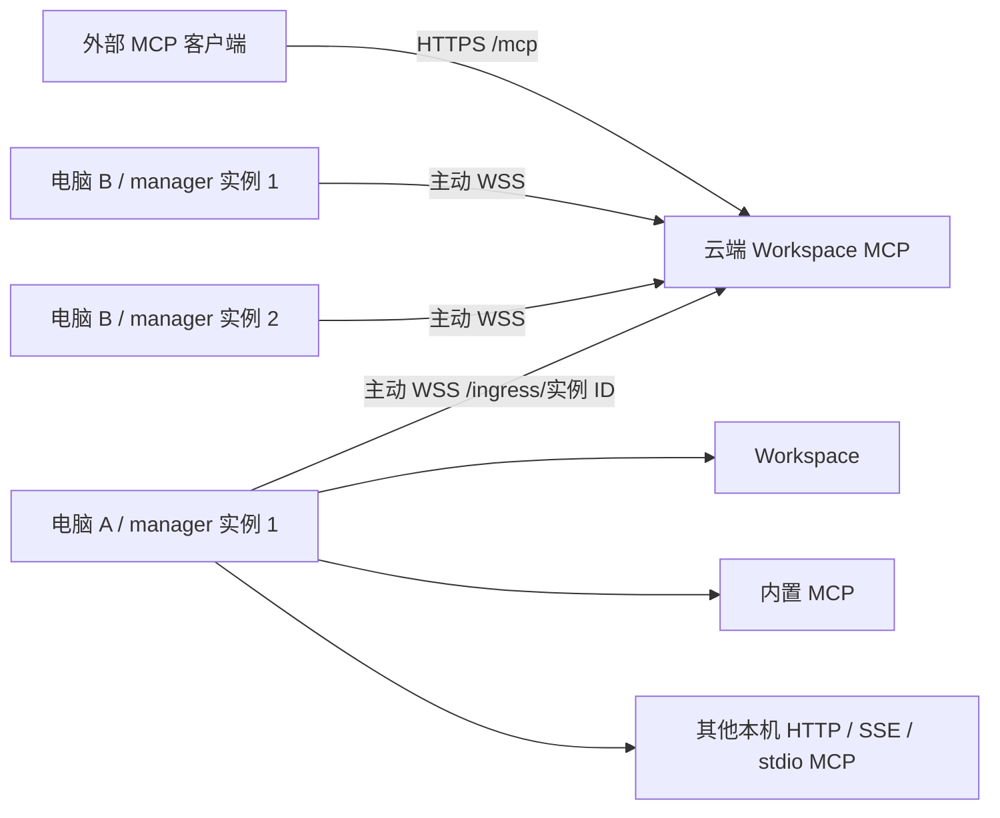

# agent-nexus (`anx`)

> 原名 mcp-manager / MCP 管理器（`mcpm`）。旧名在 1.0 之前继续可用：`python -m mcpm.cli`、`mcpm` / `mcpm-client` / `mcpm-server` 命令（会打印一行弃用提示）、`MCPM_*` 环境变量、`mcp-manager.json`（只读；第一次写入时生成 `agent-nexus.json`，旧文件一个字节都不改）、插件旧 id `workspace`（现为 `device`）。

Agent Nexus：MCP 插件管理器与云端网关（gateway）：本机服务管理、系统托盘、网页控制台，以及多电脑／多实例的主动接入。管理器与云端支持 Python 3.11+；现有 Workspace 的桌面控制和企业微信内置服务依赖 Windows。

## 安装与连接（用户）

下文的 `hub.example.test` 是占位符，换成你自己的网关域名。

1. **下载安装包**：在网关的下载页 `https://hub.example.test/downloads`（不用登录）下载 Windows 安装包；或打开 GitHub 仓库的 [Releases](https://github.com/muxigame/agent-nexus/releases)，下载最新版本的 `agent-nexus_<version>_x64-setup.exe`（Windows 10/11 x64）。同一页的 `SHA256SUMS` 可以核对文件：PowerShell 里执行 `Get-FileHash .gent-nexus_<version>_x64-setup.exe`。安装包没有代码签名证书，SmartScreen 提示时选择“仍要运行”。Ubuntu 用户下载 `agent-nexus_<version>_amd64.deb`，执行 `sudo apt install ./agent-nexus_<version>_amd64.deb`。macOS 用户下载 `agent-nexus_<version>_aarch64.dmg`（Apple 芯片）或 `_x64.dmg`（Intel），把 Agent Nexus 拖进“应用程序”；没有 Apple 开发者签名时，首次打开要到“系统设置 → 隐私与安全性”点“仍要打开”。Android 10 及以上的手机在手机上下载 `agent-nexus_<version>_arm64.apk` 并允许安装。
   - **核心和界面分开（所有平台同一个架构）**：核心（网关连接、自动更新、P2P、远程桌面、所有插件）和界面分开，类似 Clash 的服务和窗口。Windows 安装时可选“为所有用户安装”（需要管理员一次）或“仅为我安装”：前者的核心是 Windows 服务 `AgentNexus`（LocalSystem），数据在 `%ProgramData%\AgentNexus`，开机即在线、注销后不断线，由核心自己静默更新；后者保持原来的用户级运行（数据在 `%LOCALAPPDATA%\AgentNexus`）。Ubuntu 的核心是 root 系统服务 `agent-nexus.service`（数据在 `/var/lib/agent-nexus`）。窗口和托盘、以及共享当前登录桌面的会话助手都是普通用户程序，会话助手不在时核心会自动在当前活跃的会话里启动它。从旧版（用户级）切到系统服务时，原来的数据目录会搬到系统目录（原目录保留），旧的用户级核心自动停用。插件和远程终端以“执行账户”运行（设置 → 执行账户）：Ubuntu 可选任一本机账户，默认是安装它的用户；Windows 可选“当前登录的用户”（默认，插件运行在他的桌面会话里，截图、键鼠、界面自动化照常可用，切换用户后自动跟随）或 SYSTEM，没有人登录时回到 SYSTEM。
  - **Ubuntu 细节**：核心和界面分开，类似 Clash 的服务和窗口。核心（网关连接、自动更新、P2P、远程桌面、所有插件）是 root 系统服务 `agent-nexus.service`，数据在 `/var/lib/agent-nexus`，开机即运行，不依赖任何人登录，自动更新不需要密码；窗口和托盘、以及共享当前登录桌面的会话助手（`agent-nexus session`，登录时自动启动）是普通用户程序。安装包装好后几秒内自动完成设置；从旧版（用户服务）升级时，原来的 `~/.local/share/agent-nexus` 会搬到系统目录（原目录保留），旧的用户服务自动停用。插件和远程终端以“执行账户”运行（设置 → 执行账户，默认是安装它的用户；root 安装的服务器默认 root）。
  - **没有桌面的 Ubuntu 服务器**：`sudo apt install --no-install-recommends ./agent-nexus_<version>_amd64.deb`（不装 GTK/WebKit），然后 `sudo agent-nexus join <邀请码>`（加入后自动重启核心服务）。`agent-nexus service status` 查看状态和云端连接，`agent-nexus service logs -f` 看日志，`sudo agent-nexus anx <参数>` 运行其他 `anx` 命令。本机控制台用 `ssh -L 8399:127.0.0.1:8399 <用户>@<服务器>` 转发后在浏览器打开 `http://127.0.0.1:8399`。没有 systemd 的环境（容器）用 `agent-nexus --serve` 在前台运行。
2. **安装并启动**：按向导安装（只装到当前用户，不需要管理员权限）。安装后托盘出现 Agent Nexus 图标，默认随登录自动启动，可以在托盘菜单里关闭。右键托盘“打开控制台”进入本机控制台。
3. **加入你的网关**（设计 §11.5）：
   - 网关 owner 打开云端控制台 `https://hub.example.test/`（owner 密码登录），在“设备 → 邀请新设备”生成一次性邀请码（形如 `anx1.…`，或 `agentnexus://enroll?invite=…` 链接，附二维码；默认 24 小时有效，只能用一次）。也可以在网关主机上执行 `anx-gateway invite create --config /etc/agent-nexus/gateway.json`。
   - 在新设备的本机控制台打开“连接云端”页（`http://127.0.0.1:8399/cloud`，总览页上也有入口），粘贴邀请码，点“加入网关”；或者在命令行执行 `anx join <邀请码>`。设备得到自己的凭据（`secrets/cloud/device-token`），在云端控制台的设备列表里以主机名出现，可以改备注名，也可以随时“吊销”（吊销后该设备立即断开，不再重连）。
   - 0.2 之前的做法仍然有效：网关运维人员在 `gateway.json` 的 `agents` 里给这台设备分配一个 id，并把对应的设备 token 交给你。在本机执行 `anx secrets set cloud/device-token --from-file <token 文件>`（token 不会被打印），然后在控制台（或 `agent-nexus.json`）里设置 `cloud`：`{"enabled": true, "url": "wss://hub.example.test", "agent_id": "<分配的 id>", "token_secret": "cloud/device-token"}`，保存后托盘图标右下角出现绿点即表示已连接。
4. **把 ChatGPT / Claude 连到你的网关**：
   - MCP 地址是 `https://hub.example.test/mcp`。
   - ChatGPT：设置 → 连接器（Connectors）→ 创建，填入上面的地址，认证选 OAuth，按提示登录授权。
   - Claude（claude.ai 或桌面版）：设置 → 连接器 → 添加自定义连接器，填入同一地址，按提示完成 OAuth 登录。
   - 连接后先调用 `device_list`（旧名 `workspace_list`）查看在线设备，再用 `use_device`（旧名 `set_workspace`）选择设备，之后的工具调用都会在该设备上执行。设备之间复制文件或整个文件夹用 `file_copy`（后台任务），再用 `file_copy_status` / `file_copy_cancel` / `file_copy_list` 查看、取消、列出。
5. **更新**：默认自动更新（设置页可改为只提示或关闭）。Windows 和 macOS 用同一个带 minisign 签名的更新通道；Ubuntu 用 apt 安装新的 deb；Android 自动下载新的 APK 后用通知和弹窗请你确认安装（系统要求用户确认，首次还要允许 Agent Nexus “安装未知应用”）；使用流量计费网络（移动数据）时不自动下载，连上 Wi-Fi 后再下，设置页的“立即更新”照常下载。

### 运维：部署网关

每个 Release 都附带 `agent-nexus-gateway-<version>.zip`（内含 `SHA256.json` 和 `deploy/gateway/`）。在一台带 systemd 和 [uv](https://docs.astral.sh/uv/) 的 Linux 主机上：

```bash
sha=$(sha256sum agent-nexus-gateway-<version>.zip | cut -d' ' -f1)   # 与 Release 的 SHA256SUMS 核对
unzip -q agent-nexus-gateway-<version>.zip 'deploy/gateway/*' -d /tmp/anx
sudo bash /tmp/anx/deploy/gateway/install.sh --package agent-nexus-gateway-<version>.zip --sha256 "$sha"     --public-url https://hub.example.test
curl -s http://127.0.0.1:8440/healthz   # {"status":"ok","service":"agent-nexus-gateway","version":...}
```

之后的升级用 `sudo /opt/agent-nexus/bin/anx-upgrade --package <zip> --sha256 <sha>`：校验、`uv sync`、`--check-config`、备份、切换、重启并轮询 `/healthz`，失败自动回滚。反向代理示例、试运行实例（`127.0.0.1:8441`）和 GitHub Actions 部署（`deploy-gateway.yml`）见 [`deploy/gateway/README.md`](deploy/gateway/README.md)。

### 发布流程（维护者）

推送与源码版本一致的 tag（`vX.Y.Z`，见 `scripts/version.py`）后，`.github/workflows/release.yml` 构建带更新签名的 NSIS 安装包、两种芯片的 macOS 磁盘映像和更新包、Android APK（仅当配置了发布密钥库）、`latest.json`、网关 zip 和公开版 deb，检查不含私有载荷（`scripts/test_no_private_payload.py`），生成 `SHA256SUMS`，上传到 OSS（`publish-oss`：全部文件核对无误后才替换更新通道 `latest.json` 和下载页读的 `downloads.json`），建 draft release，最后由 `publish-release` 自动把它发布为 latest（预发布 tag 停在 draft）。签名密钥通过仓库 secrets `TAURI_SIGNING_PRIVATE_KEY` / `TAURI_SIGNING_PRIVATE_KEY_PASSWORD` 提供（必需，Windows 和 macOS 共用）；可选的 `APPLE_CERTIFICATE`、`APPLE_CERTIFICATE_PASSWORD`、`APPLE_SIGNING_IDENTITY`、`APPLE_ID`、`APPLE_PASSWORD`、`APPLE_TEAM_ID` 用于 macOS 的 Developer ID 签名和公证（缺省时 ad-hoc 签名）；可选的 `ANDROID_KEYSTORE_BASE64`、`ANDROID_KEYSTORE_PASSWORD`、`ANDROID_KEY_ALIAS`、`ANDROID_KEY_PASSWORD` 用于签名 APK（缺省时不发布 APK，发布照常完成；密钥库一旦启用就不能更换，否则已安装的手机无法更新）。详见 docs/design.md §11.6。公开仓库只推送由 `scripts/publish/make_public_branch.py` 生成的 `public` 分支：第一次运行是一个孤儿提交，之后每次刷新都在 `public` 原有末端上追加一个提交（`main` 的历史永远不进入 `public`），所以推送不需要 force，早先打在 `public` 上的 `v*` tag 也仍在其历史里，pre-push 钩子照常放行。

首次正式发布前的检查项：
- 钩子只写进本工作树的 git 目录；只有在存在 `origin` 远程时运行该脚本（或加 `--activate-hook`）才会设置 `core.hooksPath` 和 `remote.origin.push`，此前它不生效。
- 打 release tag 前先用 `scripts/version.py` 升版本号（tag 必须与源码版本一致）。
- Linux CI 任务尚未在 GitHub 上实际跑过；首次推送后先看 `ci.yml` 是否全绿。
- 私有版脚本仍在工作树里，`make_public_branch.py` 的禁止清单会拦下私有路径，推送前按 §11.1 人工检查 `git ls-files`。
- `ci.yml` 的 `sdk` 任务目前只跑 mcpkit 的 pytest：mcpkit 还没有 `plugin new` / `smoke` 子命令，`schemas/` 一致性检查也还不是独立步骤（§11.2 的目标）。

## Ubuntu 安装包

`artifacts/ubuntu/` 提供 Ubuntu 22.04 / 24.04 x86_64 的 `.deb` 和便携 `.tar.xz`。普通版 `agent-nexus` 默认运行本机 device 插件；私用版 `agent-nexus-private` 内置专用接入凭据，每份新安装自动生成独立的 `portable-<UUID>`，注册当前用户目录为 `home`。两种版本互斥，安装时沿用已有的用户配置、实例 ID 和凭据。

```bash
sudo apt install ./agent-nexus-private_<version>_amd64.deb   # <version> = agent_nexus.__version__
agent-nexus
```

也可以在应用菜单打开「Agent Nexus」。GTK/WebKit 桌面窗口显示启动阶段和日志；关闭窗口时释放控制台视图及其 WebKit 渲染进程，AppIndicator 托盘和后台服务继续运行。从托盘打开会重建窗口，保留页面设置和普通窗口尺寸，不重复启动后台或刷新计时器；最小化时暂停页面轮询和日志订阅。右键可以管理服务或「退出管理器并停止所有服务」。Ubuntu GNOME 使用系统的 AppIndicator 扩展。实际 manager 使用独立的 Python 3.12 环境，首次启动需联网下载依赖，不修改系统 Python。后台由当前用户的 `agent-nexus.service` 管理，停止时清理该实例拥有的进程。该服务不会默认启用开机或登录自启动。

配置、凭据和数据默认保存在 `$XDG_DATA_HOME/agent-nexus/`（即 `~/.local/share/agent-nexus/`）；启动日志在该目录的 `.anx/logs/startup.log`。`ANX_ROOT`（旧名 `MCPM_ROOT`）可指定另一个实例的数据目录。旧版的 `~/.local/share/roc-mcp-manager/client/` 不会被改动，复制迁移由 `anx migrate` 完成。无图形环境可以解压便携包并执行 `./start.sh --serve`；图形方式需要安装上面 `.deb` 所列的 GTK/WebKit/AppIndicator 依赖。

旧版 mcp-manager 0.1.3 曾在真实 Ubuntu 22.04 GNOME 桌面完成安装、窗口渲染、隐藏后后台存活、恢复窗口、托盘退出及公网命令／补丁验收。Debian 数据归档使用 GNU tar 格式并显式包含全部父目录；发布检查拒绝 PAX 扩展头，避免旧版 dpkg 在长文件名处安装失败。

Linux Workspace 提供命令、续接会话、文件补丁、图片、计划和 watcher 工具；Windows UIA、鼠标键盘、Windows OCR 等桌面控制工具仅在 Windows 上暴露。企业微信内置 MCP 仍限定 Windows，其他 MCP 可按需要启用或接入。所有接入继续使用同一个云端 `/mcp`，通过 `set_workspace` 选择电脑和实例。

构建：`make ubuntu LINUX_UV=<Linux x86_64 uv 路径>`；私用版增加 `make ubuntu-cloud LINUX_UV=<路径> ENROLLMENT_FILE=<私密接入配置>`。发布包中携带 Linux ELF 的 `tools/uv`，不会混入 Windows exe。私用版包按私用分发文件保存。

## 云架构



云端只有一个对外 MCP 端点 `/mcp`，并提供接入点 `/ingress/{agent_id}`。本机 manager 主动发起连接，电脑无需公网监听端口。接入凭据按实例分别设置，与外部 MCP 客户端使用的凭据分开；一个实例 ID 同时只能有一个连接。多台电脑和同一电脑的多个实例均可接入，使用不同实例 ID；本机多个实例应使用独立配置根目录、管理器端口和服务端口。

默认工具列表（`gateway.tool_listing = "compact"`）只展开常用的设备工具（命令、文件、编辑、搜索、图片），并追加：

| 工具 | 用途 |
| --- | --- |
| `device_list` | 列出设备，带显示名、能力、可用 shell 和工作目录 |
| `use_device(device_id, workdir?)` | 选设备和工作目录，返回 `workspace_id`（之后发给这台设备的调用都带上它）、`shells` 和 `shell_default` |
| `mcplist(agent_id?)` | 查看内部 MCP 列表；标识为 `实例/服务` |
| `toolsearch(query, agent_id?, limit?, offset?)` | 搜索没有直接列出的工具（桌面控制、watcher、插件、连接器等），每条结果直接带参数定义 |
| `tooluse(tool, arguments?, mcp_id?, workspace_id?)` | 调用找到的工具：`tool` 可以是裸名或 `server.tool`；透传文本、图片、结构化结果、元数据与工具错误 |
| `exec_wait(session_id, timeout_ms?)` | 等待仍在运行的命令；超时后用同一个 id 再调 |

旧名 `workspace_list`、`set_workspace`，以及 `mcpdetail`、`mail_bye`、`mail_recall`、`mail_status`、`file_copy_cancel`、`file_copy_list`、桌面控制和 watcher 等少用工具不在列表里，但照样可以按名字调用。`"full"` 恢复完整列表。每次调用最多阻塞 `gateway.tool_wait_max_s`（默认 50 秒）就返回可继续的句柄，因为 MCP 客户端会在约 60 秒时自己切断。详见 `docs/design.md` §20。

Workspace 工具增加可选 `workspace_id` 参数。不传时用当前设备：有会话的传输里是 `use_device` 选的设备，经本机 MCP 时是这台设备自己，只有一台设备在线时是它。当前部署沿用原 Workspace 的 `stateless=true`，本机 MCP 也不保留会话，所以 `use_device` 之后发给那台设备的每次调用（包括 `mail_*`、`ask_user`）都要携带它返回的 `workspace_id`，否则经本机 MCP 的调用会落在这台设备自己；配置为有会话模式且使用旧版有会话的客户端时，也可以使用当前会话的选择。该句柄空闲 24 小时后过期。连接中只有一个 workspace 时会自动选择；也可以在云端配置 `default_workspace`，例如 `{"agent_id":"office-pc-main","workspace":"projects"}`。存在多个 workspace 且没有明确选择时，执行请求会返回选择提示，不会随机切换电脑。

Workspace 是工作目录的路由和默认值：调用上游带 `workdir` 参数的工具时填入所选路径，显式传入的 `workdir` 保持有效；访问边界仍由各本机 Workspace 的 `allowed_roots` 等配置控制。目录名、路径和实例信息由本机配置注册，云端 `set_workspace` 不能任意增加本机目录。

### 云端启动

部署布局（以下均为占位符，按自己的环境替换）：公网 MCP 端点为 `https://<hub-domain>/mcp`，manager 接入源站为 `wss://<hub-domain>`（接入路径自动追加 `/ingress/{agent_id}`）。参考部署把后端放在 `/opt/agent-nexus/current`，配置为 `/etc/agent-nexus/gateway.json`，由 `agent-nexus-gateway.service` 管理并开机启动，以独立的非特权系统账号运行；首次安装与升级用网关 zip 自带的 `deploy/gateway/install.sh` 与 `deploy/gateway/upgrade.py`（安装为 `/opt/agent-nexus/bin/anx-upgrade`），路径、端口和期望哈希都通过参数传入；`scripts/upgrade_cloud_release.py` 只是兼容旧命令行的包装。

认证沿用原 Workspace：OAuth + 原 Bearer，动态客户端注册（DCR）、PKCE S256、`tools` 权限、30 天 access token、原 issuer/resource、标题、授权密码和授权数据库。云端认证秘密位于 `<config-dir>/secrets/workspace/`，OAuth 数据库位于 `<state-dir>/oauth.sqlite3`。接入凭据独立于外部 MCP 凭据，保存在云端的 env 文件（如 `<config-dir>/gateway.env`）中；本机通过配置 `cloud.token_secret` 引用受保护的 `secrets/cloud/<secret-name>`，无需把 token 写进配置或系统环境变量。

Workspace 配置的 `auth.redirect_uris` 同时允许现有 ChatGPT 回调和 Claude 官方回调 `https://claude.ai/api/mcp/auth_callback`（见 `config/server.workspace.example.json`）。现有部署需将该地址对应的完整匹配表达式加入云端 `gateway.json` 后重启网关服务；无需更换 OAuth Client ID、密码或授权数据库。Claude 使用公共客户端动态注册，`token_endpoint_auth_method` 为 `none`。

前置反向代理（例如 nginx）只需把 `https://<hub-domain>` 转发到网关监听的 `127.0.0.1:8440`，并为 `/ingress/` 开启 WebSocket 升级、为 `/mcp` 关闭响应缓冲。证书续期等运维细节不在本仓库内。

需要在本机调试云端时，可以通过 SSH 端口转发访问网关（仍需 Bearer 凭据）：

```bash
ssh -N -L 127.0.0.1:18440:127.0.0.1:8440 <deploy-user>@<hub-host>
# 然后访问 http://127.0.0.1:18440/mcp
```

公网验收脚本都要求显式传入地址，例如 `uv run python scripts/probe_cloud_release.py --url https://<hub-domain>`（也可以设置环境变量 `ANX_HUB_URL`）。

`make server` 单独生成 `artifacts/agent-nexus-server.zip`，`uv run python scripts/build_release.py gateway` 生成发布用的 `agent-nexus-gateway-<version>.zip`（多带 `deploy/gateway/`），都不依赖 Rust、Linux uv 或私用接入凭据。解压 server 包，编辑 `gateway.json`，设置公网域名和允许接入的实例 ID。示例中的 `agents` 值是环境变量名，变量内容是各实例的独立 token（至少 32 字符）。

```bash
# 先配置 ANX_SERVER_TOKEN、ANX_OFFICE_TOKEN、ANX_HOME_TOKEN 环境变量（旧名 MCPM_* 仍然有效）
uv run anx-gateway --config gateway.json --check-config
uv run anx-gateway --config gateway.json
```

将同一公网 HTTPS 域名反向代理到云端配置的端口（默认 `127.0.0.1:8440`）。代理需支持 `/ingress/` 的 WebSocket 升级，和 `/mcp` 的 MCP HTTP 请求／流式响应。外部客户端连接 `https://你的域名/mcp`，使用 `ANX_SERVER_TOKEN`（旧名 `MCPM_SERVER_TOKEN`）的 Bearer 凭据。

需要现有的 OAuth 登录时，云端支持沿用 mcpkit 的 `auth` 配置：在 server 配置中写 `public_url` 与 `auth`，凭据文件位于解压目录的 `secrets/`；`auth` 的格式与本文后面的集中配置一致。显式 `auth` 替代 `token_env` 的默认 Bearer 认证。

当前 server 为单进程：实例连接与 workspace 句柄保存在内存中，部署时运行一个 worker。重启后本机自动重连，客户端重新选择 workspace。多副本部署需要另外实现共享注册表和跨进程 RPC，当前不包含此能力。

同一 workspace 可以并发调用。上游连接按服务和 workspace 上下文复用；建立或回收一个连接不会占用其他连接所需的全局锁。`rpc_timeout_s`（默认 180 秒）覆盖请求排队、发送和等待结果，取消通知与连接清理另有短时限。断线或超时不会自动重试工具，因为命令可能已经执行。连接容量包含正在建立和正在关闭的连接，避免并发回收时突破上限。

### 本机启动

解压 client 包并编辑 `agent-nexus.json`（或在已有配置中添加 `cloud`）：

```json
{
  "manager": {"host": "127.0.0.1", "port": 8399},
  "builtins": true,
  "scan": ["external"],
  "cloud": {
    "enabled": true,
    "agent_id": "office-pc-main",
    "url": "wss://你的域名",
    "token_env": "ANX_AGENT_TOKEN",
    "workspaces": {
      "projects": {"path": "C:/Projects", "mcp": "workspace"},
      "research": {"path": "D:/Research", "mcp": "workspace"}
    },
    "mcps": {
      "extra-http": {"url": "http://127.0.0.1:8500/mcp"},
      "extra-stdio": {"command": ["node", "server.js"], "cwd": "external/example"}
    }
  },
  "services": {}
}
```

`ANX_AGENT_TOKEN` 的内容需与云端该实例的 token 相同。设置 `cloud.enabled=true` 后，普通 `anx serve`／桌面入口会同时启动本机服务管理与云端连接，控制台总览显示连接状态。也可运行独立 client：

```bash
uv run anx-agent --root . --check-config
uv run anx-agent --root .
# 不自动启动服务，只聚合已经在本机运行的服务：
uv run anx-agent --root . --no-autostart
```

额外 MCP 支持 HTTP、`transport: "sse"` 或 stdio `command` 数组；需要 Bearer 的 HTTP/SSE 服务设置 `token_env`。已有内置服务的端口、启停及 `auth.bearer_secrets` 会自动读取，凭据只保留在本机，不上传到云端目录。未配置 `workspaces` 时，使用 `services.workspace.settings.default_workdir`，未设置则用用户主目录。

本机接入凭据也支持 `cloud.token_secret`，例如 `"cloud/agent-token"`：从配置根目录的 `secrets/cloud/agent-token` 读取，不依赖登录用户的环境变量。配置 `token_secret` 时优先于 `token_env`。

断线后按 1 到 30 秒退避重连；工具执行不会自动重试，以免重复执行有副作用的操作。执行超时或连接断开时结果可能未知，应先检查目标状态。目录每 30 秒刷新，支持新加本机 MCP；闲置上游会话默认 1 小时回收，每实例默认最多 256 个上游会话，可以用 `max_sessions`、`session_idle_ttl_s` 调整。

### 内置目录与构建产物

本仓库的 `builtins/` 只包含 `device`（原 `codex-mcp`，旧插件 id `workspace` 作为别名保留）和共享 `mcpkit`。`ones-mcp`、`payment-mcp`、`wechat-mcp`、`chrome-devtools-mcp`、`unity-mcp`、`jubian-go-mcp` 在各自的私有仓库中维护，已被 `.gitignore` 排除；本地构建时如果 `builtins/` 下恰好有它们的检出，就一并打包，没有则跳过（设置 `ANX_REQUIRE_ALL_BUILTINS=1` 可恢复“缺一个就报错”的旧行为）。私用版和完整构建（`make` / `make build`、`make private-desktop`、`make ubuntu-cloud`、`make check-client-inputs`）由 Makefile 自动设置 `ANX_REQUIRE_ALL_BUILTINS=1`，缺少任何业务插件都会直接失败。`chatx` 是桌面应用，继续独立保存。

客户端源码包和 manager wheel 包含所有内置 MCP 的运行源码，DevTools 的上游 JS 也会一起打包；Python 依赖由 uv 按锁文件安装，DevTools 仍需要 Node，Unity 仍需要 Editor 侧插件。可选视觉模型权重按原流程下载。server 包仅包含云端网关和共享认证库。发布包不包含本机 token、OAuth 数据库、微信数据、收款业务配置、日志、虚拟环境或 Git 目录；收款业务配置可按 `config.example.json` 自行创建。

```bash
make check       # manager 测试和桌面编译检查
make             # 一次生成 Windows/Ubuntu 普通与内置凭据版、便携包、wheel、client/server ZIP，并核验产物
make build       # 同 make
make server      # 仅生成 server ZIP；可在没有 Rust 的云端使用
make distributions # 仅构建 wheel、普通桌面程序及 client/server 源码 ZIP，不要求私用凭据
make verify      # 构建 distributions 并检查清单、数据排除、异地解压后的入口
```

ZIP 内有 `SHA256.json` 文件清单；Python wheel 位于 `artifacts/python/`，安装 wheel 时也需安装同目录的 mcpkit wheel。这些 ZIP 是包含内置源码的可运行发行包，不是内嵌 Python/Node 的免依赖单文件程序。

默认 `make` 的四个主要制品为 `artifacts/agent-nexus.exe`、`artifacts/agent-nexus-private.exe`、`artifacts/ubuntu/agent-nexus_<version>_amd64.deb`、`artifacts/ubuntu/agent-nexus-private_<version>_amd64.deb`（`<version>` 取自唯一版本源 `agent_nexus/__init__.py`，见 `make version-check`；私用版只在本地构建，从不进入公开 CI）。同一次构建还生成两份 runtime ZIP、两份 Ubuntu 便携 tar.xz、两份 Python wheel，以及 `agent-nexus-client.zip` 和 `agent-nexus-server.zip`，共 12 个文件。最后检查所有产品的当前源码、文件清单、归档权限、EXE 内嵌 runtime 和凭据边界，结果写入 `client-artifacts.json`。

可以用 `make ARTIFACT_DIR=artifacts/my-release` 将全部产物放到独立目录；目录名含空格时将整个参数放入引号。普通版与内置凭据版分别使用 `target` 和 `target-portable` Rust 构建缓存，各自显式绑定本次 runtime；client ZIP 只接受本次输出目录的普通 EXE，不会回退到其他目录的旧文件。构建不启动或重启管理器及服务。

默认输入为 `LINUX_UV=artifacts/uv-linux-amd64` 与 `ENROLLMENT_FILE=secrets/build-enrollment.json`，独立于输出目录，可通过 make 参数覆盖。缺失输入会在开始编译前明确报错。私用凭据输入仅进入内置凭据版，不进入普通版、wheel 或 server 包；已有 key 不会写入构建日志。`make server` 继续可单独运行，不要求 Rust、Linux uv 或私用接入配置。

## 启动

Windows 上直接运行桌面程序 `agent-nexus.exe`。exe 内含 client 源码、内置 MCP 和 uv，可以单独复制到新电脑。没有现有配置时，自动释放到 `%LOCALAPPDATA%\AgentNexus`（旧版的 `%LOCALAPPDATA%\Roc\MCPManager\client` 保持原样，作为回滚目标），首次联网下载 Python 3.12 和依赖，显示实际准备阶段、耗时与启动日志。失败会显示原因，可从托盘重试；日志位于配置根目录的 `.anx/logs/startup.log`。新配置默认仅启动本机 device 插件，云端连接需要配置该实例自己的接入凭据。

已有配置时沿用配置根目录，检查管理器的 `/api/ping`；管理器没有运行时在后台直接启动 `anx serve --tray`，自动启动全部 `autostart` 服务。管理器已经运行时不会重复启动。Windows 关闭窗口会释放控制台 WebView，后台管理器、受管服务和托盘继续运行；再次打开时重建窗口，恢复标签、窗口尺寸和未保存的端口输入。托盘「退出管理器并停止所有服务」才退出管理器与全部受管服务。

控制台最小化时暂停状态轮询和日志订阅，恢复后重新连接；Windows 原生窗口状态会显式通知网页，不依赖 WebView2 的 `document.hidden`。日志视图最多保留 5000 行，并限制单行长度与总字符数；完整日志仍保存在原日志文件。过滤条件、暂停状态和日志来源会保留，日志正文不写入 localStorage。

```powershell
.\agent-nexus.exe.lnk    # 根目录快捷方式；启动整套 MCP 并打开控制台
```

其它系统，或想在前台看输出：

```bash
cd WorkSpace/mcp
uv run --project agent-nexus anx serve --tray --open
```

`anx.ps1` / `anx.sh` 不带参数时等于 `serve --tray --open`，带参数时原样转给 `anx`。

控制台地址 `http://127.0.0.1:8399`（端口在 `agent-nexus.json` 的 `manager.port`）。

## 托盘

- **图标上的圆点**汇总所有服务：绿 = 运行中，黄 = 有服务在启动，红 = 有服务崩溃 / 端口冲突 / 不健康 / 配置错误。鼠标悬停显示 `几/几 运行中` 和出问题的服务名。
  只观察的服务（见下文）不会让圆点变红：它有问题时是黄点，它没在运行（比如浏览器关了）不影响颜色，也不计入 `几/几`。
- **左键**打开控制台：装好桌面窗口时开窗口，否则退回浏览器（见下文「桌面窗口」）。
- **右键菜单**：打开控制台；每个服务一个子菜单（状态、查看状态和日志、启动 / 重启 / 停止）；重新扫描服务；打开 MCP 目录；退出管理器。
- 服务崩溃或出现端口冲突时弹系统通知。
- **退出管理器会停止全部受管服务**，包括此前异常退出后由新 manager 安全接管的服务；只观察的程序和未经 manager 接管的外部端口进程不会被关闭。
- 接管“外部进程”要结束一个不是 agent-nexus 启动的进程，只能在控制台里做（有二次确认），托盘里只提供跳转。
- 没有桌面环境（比如无图形界面的 Linux）时 `--tray` 自动降级为无托盘运行。

## 桌面窗口（Tauri）

### 私用自动接入版

`artifacts/agent-nexus-private.exe` 是单独构建的私用版本（只在本地构建），内含专用的云端接入凭据，首次启动为每份新安装生成并保存 `portable-<UUID>`，不同电脑不会使用同一个实例 ID。沿用已有已启用的云端配置，不替换原实例或凭据。新电脑注册的 `home` workspace 是当前用户目录。复制 exe 即可；复制整个已经初始化的数据目录会复制实例 ID，应使用新的数据目录。

凭据仅用于 `portable-` 实例接入，不能替代公网 MCP Bearer 或 OAuth。云端 `agent_groups` 将 `portable-` 前缀绑定到独立 `ANX_PORTABLE_TOKEN`（变量名是数据，沿用旧名 `MCPM_PORTABLE_TOKEN` 也可以）；明确配置的实例仍优先使用自己的凭据。撤销便捷版时删除这个前缀配置或轮换该变量。普通 client/server 构建不打包任何接入凭据。

维护者通过 `make private-desktop ENROLLMENT_FILE=<私密JSON路径>` 构建，JSON 格式为 `{"url":"wss://<hub-domain>","agent_prefix":"portable-","token":"<专用接入凭据>"}`。私用构建**必须**另外给出 `ANX_ENROLLMENT_ENDPOINT=wss://<hub-domain>`（或 `make ... ENROLLMENT_ENDPOINT=wss://<hub-domain>`），JSON 里的 `url` 必须与它一致，否则构建失败——接入地址不能只由凭据文件自己证明；构建会把该地址写入 runtime 的 `.private/endpoint-allow`，运行时只接受其中列出的地址。私密 JSON、exe 和 `artifacts/private/` 都按私用分发文件保存，避免放进公开发行包。运行后凭据另存为配置根目录下的 `secrets/cloud/enrolled-agent`，限制为当前账号与 SYSTEM 访问。

`desktop/` 是一个 Tauri 启动器和外壳窗口，**启动管理器后加载的就是管理器自己在本机提供的那个控制台页面**。
这样界面只有一套代码，控制台原有的 Host / 同源校验照常生效；窗口不注册任何 Tauri 命令，
页面拿不到任何在浏览器标签页里拿不到的能力。

```bash
cd agent-nexus
make desktop                  # 先生成内嵌运行包，再构建 artifacts/agent-nexus.exe
```

构建之后，托盘左键、右键菜单里的「查看状态和日志」、`anx open`、`serve --open` 都会开这个窗口；
没构建（或在别的系统上）自动退回浏览器，不会报错。重复打开会聚焦已有窗口，不会叠开第二个。
想指定别处的可执行文件用环境变量 `ANX_DESKTOP_APP`（旧名 `MCPM_DESKTOP_APP`）。

双击桌面程序本身也会确保管理器已经启动，因此 Windows 不再需要单独的 `start-all.ps1`。

前置条件（本机已具备）：Rust 工具链、Visual Studio C++ 生成工具、WebView2 运行时。

## 图标

服务目录里放一张 `favicon.png` 就会自动显示在控制台（总览、标签页、`+` 菜单、服务详情）。

- 查找顺序：清单里的 `icon` 字段 → `favicon.png` → `favicon.svg` → `favicon.ico` → `icon.png`。
- 支持 png / svg / ico / jpg / webp，**不超过 10KB**，必须在服务目录内。不符合时控制台“启动配置”里会写明原因，并用首字母色块代替。
- 替换图标后控制台自动刷新（地址里带文件修改时间）。
- 管理器自己的图标在 `agent_nexus/static/icon.png`，托盘和网页标签都用它。

## 服务怎么被发现

### 自注册：`mcp-service.json`

扫描根目录（`scan`，默认 `.`）下的每个子目录，含 `mcp-service.json` 的就是一个服务。新增服务只需要在它自己的目录里放这个文件。

| 字段 | 说明 |
| --- | --- |
| `name` | 服务名，默认用目录名 |
| `command` | 启动命令（字符串数组）。也可以按平台写：`{"win32": [...], "default": [...]}` |
| `cwd` | 工作目录，相对服务目录，默认 `.` |
| `port` / `host` | 端口 / 监听地址（默认 `127.0.0.1`） |
| `env` | 额外环境变量 |
| `health` | `{"path": "/health", "interval": 30}`：HTTP 探测路径和间隔（秒）。任何 < 500 的响应都算活着 |
| `logs` | 额外日志文件（相对服务目录），控制台里可切换查看 |
| `icon` | 图标文件（相对服务目录），不写则自动找 `favicon.png` 等 |
| `platforms` | 限定平台，如 `["win32"]`；为空表示不限 |
| `autostart` | `anx serve` 时自动启动 |
| `autorestart` | 崩溃后自动重启（5 分钟内最多 5 次，退避 2s→30s） |
| `enabled` | `false` 则不启动 |

`command`、`env` 里可以用占位符 `{port}`、`{host}`、`{dir}`（服务目录）。

### 只观察的服务：`"kind": "observe"`

有些东西值得在控制台里看到，但不该由管理器启停——浏览器就是典型，对它“重启”等于关掉所有标签页。这类服务不写 `command`，而是指定一个检测器：

```json
{
  "name": "edge-webmcp",
  "kind": "observe",
  "description": "Edge 的 WebMCP 和远程调试端口",
  "observe": { "detector": "chromium-webmcp", "browser": "edge", "interval": 10 }
}
```

| 字段 | 说明 |
| --- | --- |
| `observe.detector` | 检测器名，目前只有 `chromium-webmcp` |
| `observe.browser` | `edge`（默认）或 `chrome` |
| `observe.user_data_dir` | 非默认配置目录时指定（Beta / Dev / 自定义 `--user-data-dir`） |
| `observe.interval` | 检测间隔秒数，默认 10，最小 5 |

- `start` / `stop` / `restart` 在 supervisor 里直接拒绝，控制台、托盘、命令行都一样；控制台和托盘不显示这些按钮，`restart all` 会跳过它。
- `command`、`port`、`autostart`、`autorestart` 对它无效（写了也被忽略），唯一能改的是 `enabled`。
- 管理器从不把被观察的 pid 记成自己的进程；别的服务“接管”端口时，如果要结束的进程树和被观察的进程树有重叠，会拒绝执行。
- 检测器只读进程表和文件，**不连接**被观察的程序。
- 状态：运行中 / 未运行 / 不健康；每次状态变化在日志页记一行。
- `anx status` 里 PID 列显示为 `~<pid>`，HEALTH 列为 `observe`。

`chromium-webmcp` 显示：浏览器版本、主进程和进程数、WebMCP 是否已加载（子进程的 `--enable-features`）、`enable-webmcp-testing` 的 flags 设置、远程调试端口及开启方式。flags 开了但没加载、被 `--disable-features` 关闭、或调试端口监听在非本机地址时为“不健康”。

### 集中配置：`agent-nexus.json`（旧名 `mcp-manager.json`）

```json
{
  "manager": { "host": "127.0.0.1", "port": 8399 },
  "scan": ["."],
  "services": {
    "workspace": { "port": 8410 },
    "other": { "dir": "../elsewhere/other-mcp", "command": ["node", "server.js", "--port", "{port}"], "port": 8420 }
  }
}
```

- 和某个自注册服务同名：**覆盖**清单里的字段（`env` 按键合并）。
- 没有同名清单：单独定义一个服务，需要 `dir` 和 `command`。
- 控制台 / `anx port` 改端口时写的就是这里（根目录只有旧的 `mcp-manager.json` 时，第一次写入会生成 `agent-nexus.json`，旧文件不动），不改服务仓库里的文件。

## 插件库（网关上的私有插件）

私有插件（ones、jubian-go、payment、wechat、unity、chrome-devtools 等）以**插件包**的形式保存在网关上（决策 D4r，`docs/design.md` §6.12），在网关控制台“插件 → 插件库”点“安装到…”就能装到任意在线设备，在本机控制台“插件 → 安装插件 → 插件库”也能直接装：

1. 打包：`anx plugin pack <插件文件夹> [-o x.zip]`。不带 `.venv`、`node_modules`、`.git`、`tests`、日志、`secrets`、`config.json`（保留 `*.example.json`）、数据库、`.env*`、`*keys*.json`、`oauth*.json` 和插件声明的数据目录；发现疑似凭据（私钥、令牌、写死的密码……）就拒绝打包并列出文件，没有绕过的开关。
2. 上传：网关控制台“上传插件包”，或在已加入网关的设备上 `anx plugin publish <文件夹|zip>`（用这台设备自己的凭据经 HTTPS 上传；吊销的设备会被拒绝；设备只能发布自己的插件，不能覆盖所有者或其他设备上传的包，也不能给它们加新版本），或在网关主机上 `anx-gateway plugin-repo add --config gateway.json x.zip`。网关会重新检查清单、凭据、大小（`plugin_repo.max_package_mb`，默认 300）并计算 sha256。
3. 安装：设备用自己的设备凭据从网关下载，校验 sha256 后走普通的安装流程（安装依赖 → 健康检查，失败回滚）；锁文件记 `source.type = "hub"`。需要账号的插件装好后在设备上填写配置。

升级、降级或同版本重装时，写在插件代码目录里的数据（payment 的 `config.json`、`qrcodes/` 等）会搬到新版本目录，不会丢。打包时文档里的企业微信账号目录、成员 ID 和示例 UUID 会换成占位符（源文件夹不改）。

插件包是私有的：存放在 `<state_dir>/plugin-repo/`（只有 owner 可读），不会出现在 `/downloads`，只有 owner 和未吊销的设备能下载；**插件包永不提交到公开仓库，也不进入 CI 或 Release**。

## 设备之间互相操作（私有网络）

加入同一个网关的设备组成一个私有网络：**任何一台客户端都可以打开其他设备的终端和远程桌面、吊销或删除它们**，不需要额外的密码。

- **客户端 → 设备**：本机控制台（桌面应用窗口）左侧的 **设备** 页列出网关里的所有设备。
  - **远程桌面**：查看并控制对方桌面（内置 VNC + noVNC，画质可调、全屏、Ctrl+Alt+Del）。画面是 H.264：对方用显卡硬件编码（NVENC / Quick Sync / AMF / Media Foundation / VAAPI，都没有时 libx264），这边用 WebCodecs 硬件解码，对方主动推帧（不等每帧往返）；不支持 H.264 的查看端自动改用 JPEG。鼠标是本地的、零延迟，对方的指针形状（箭头、输入光标、手形……）同步过来。没有桌面的服务器不提供，只有终端。
  - **终端**：在窗口里打开对方的 shell（xterm.js，Windows Terminal 风格）；“⋯ → 在本机终端打开”用这台电脑的终端（装了 Windows Terminal 就用它）。Windows 上有 PowerShell 7 / Windows PowerShell / 命令提示符 / Git Bash / WSL；Linux / macOS 上有 bash、zsh、fish 等。终端页下方列出对方的命令行环境（Claude Code、Codex、git、node、python、uv、docker……及版本）。
- **打洞直连（muxi-p2p）**：终端和远程桌面优先走设备之间的直连——IPv6 / 局域网 / 路由器端口映射，其次 UDP+QUIC 和 TCP 打洞，数据不经过网关；页面上的标签写着实际走的路线。终端在直连失败时自动退回网关中转（标签会写原因）；远程桌面只走直连。
- **没有桌面的机器**：`agent-nexus term [设备]`（Windows 上 `anx term`），`Ctrl+]` 再按 `q` 退出；`--shells` 列出对方的 shell 和命令行工具。
- **文件复制（AI 可用）**：`file_copy(src_device, src_path, dst_device, dst_path, overwrite=false)` 把一个文件或整个文件夹（递归）从一台设备复制到另一台（或同一台的另一个位置），几 GB 的二进制数据也可以；立即返回 `job_id`，用 `file_copy_status(job_id, wait_ms=30000)` 看进度（文件数、字节数、速度、剩余时间、实际线路、错误），`file_copy_cancel` 取消，`file_copy_list` 列出最近的任务。任务由源设备（或目标设备）自己执行，数据优先走直连或中转设备（端到端加密），不经过网关；两端客户端都太旧时才由网关中转（慢，返回里会说明），`route="p2p"` 可禁止网关中转。每个文件写到临时名、核对 sha256 后才改名；重复执行同一个复制会跳过已有的相同文件、续传没传完的文件（任务 `interrupted`、因对方离线而 `failed` 或状态 `unknown` 时，用相同参数再调用一次即可；这也是单向同步的方式，目标端从不删除文件）；`overwrite=false` 时不同内容的已有文件只报错不覆盖，`overwrite=true` 覆盖时保留原文件的权限和属主，新文件沿用源文件的权限位；符号链接不跟进，复制途中被换成链接的文件或文件夹也不会被读写。设备 `agent-nexus.json` 写 `"files": {"jobs": false}` 不在本机运行复制任务，`"files": {"enabled": false}` 完全关闭文件传输。详见 docs/design.md §18。
- **本机 MCP（不用填网关地址和令牌）**：装了客户端的电脑在本机控制台端口的 `/mcp`（默认 `http://127.0.0.1:8399/mcp`）提供一个本机 MCP，工具和网关 MCP 完全相同（device_list、use_device、各设备的工具、mail_*、ask_user、file_copy……），调用方记为这台设备；不需要任何凭据，只接受本机的连接，设备凭据始终留在客户端进程里。客户端会自动在已安装的 Claude Code（`~/.claude.json`）、Codex（`~/.codex/config.toml`）、Gemini CLI（`~/.gemini/settings.json`）里写入一个名为 `agent-nexus` 的配置项指向它（写入前备份，可在“设置 → 本机 MCP”移除；关掉开关会一并移除）。已经通过云端网关接入的 CLI——配置里已有网关地址，或者在 Claude.ai / ChatGPT 账户里加过 Agent Nexus 连接器——不会重复添加。Agent Nexus 发起的对话会自动带上这个连接器和已选好的工作区（`workspace_id`），模型不用先调 device_list / use_device。设备锁定或被吊销时它只提供一个 `nexus_status` 工具；网关主人可以在网关控制台“设置 → 在 AI 客户端中添加 Agent Nexus”关闭设备接入；网关需要 0.8.31 以上。命令行：`anx mcp status`、`anx mcp unlink --all`；卸载客户端时会自动移除这些配置项。详见 docs/design.md §19。
- **锁定**：右上角的锁。锁定后这台电脑**不能操作其他设备，但其他设备仍然可以操作它**；锁定密码可选（设置 → 锁定密码）。网关同样拒绝已锁定设备发起的操作。

每台设备的客户端带着 `tools/muxi-p2p-agent`（和 MsQuic），作为后台进程向网关的信令（`/p2p`）登记自己并响应打洞；对方每次连接都要先经网关向这台设备要一张一次性票据（60 秒，只能用一次）。网关在 UDP 45701–45703、TCP 45711–45712 上运行反射器（`gateway.json` 的 `p2p.reflector_hosts` 写网关自己的公网 IP，不要写 CDN 的域名），防火墙需要放行这些端口。Windows 第一次运行直连组件时可能弹出防火墙提示，允许即可（不允许也能打洞，只是少了局域网直连）。

**自动更新**：设置 → 更新 → “自动更新”开关（`agent-nexus.json` 的 `desktop.update.mode`：`auto` / `notify` / `off`）。打开后每 5 分钟检查一次，发现新版本自动安装并重启。**没有桌面的设备（Ubuntu 服务器）默认打开**；Ubuntu 上自动安装需要以 root 运行或免密 sudo，否则只记录原因、不弹密码框。

**网关自动更新（固定开启）**：网关主机上的 `agent-nexus-gateway-update.timer` 每分钟对照下载镜像的 `downloads.json`（几 KB），有新的正式版就下载、校验 SHA-256 并交给 `anx-upgrade`（失败自动回滚，同一版本 6 小时后再试）。CI 只发布新版本，不再部署；`deploy-gateway.yml` 只留作手动回滚或部署试用实例。

**连接器（客户端）**：本机控制台“连接器”页可以把本机已有、但不归 agent-nexus 管的 MCP 服务（编辑器自带的 MCP、自己起的服务、一条 stdio 命令）接进来，和插件一样出现在网关里；令牌或请求头存在本机 `secrets/connectors/`，不写进配置。

Ubuntu 包在“设置 → 更新”里检查更新（从加入的网关取最新的 `.deb` 和 SHA-256），点更新后用系统的授权窗口（pkexec）安装并自动重启；没有图形界面时给出要在终端里运行的命令。

设备上 `agent-nexus.json` 写 `"terminal": {"enabled": false}` / `"desktop": {"enabled": false}` 就不让别人打开这台的终端 / 桌面。直连和远程桌面需要网关和双方客户端都在 0.5.0 以上。

## 命令行

```text
anx serve [--tray] [--open] [--no-autostart]    启动管理器和控制台
anx status [--json]                             服务列表
anx start|stop|restart <name|all>               启停；stop/restart 加 --takeover 可接管外部进程
anx port <name> <port>                          改端口（需重启该服务生效）
anx logs <name> [-n 200] [-s 0] [-f]            看日志；-s 选额外日志的序号
anx open                                        打开控制台
anx shutdown                                    停止管理器及全部受管服务
anx migrate [--from 旧根] [--to 新根] [--in-place] [--apply]
                                                把旧 mcp-manager.json 复制迁移成 agent-nexus.json（默认只打印计划）
anx secrets restore --vault <保险库> [--apply]   按保险库清单把凭据配回（默认只打印计划，不覆盖）
anx secrets set <name> --from-file <path>       从文件写入一个凭据（不回显内容）
anx join <邀请码> [--agent-id <id>]               用邀请码加入网关（anx1.… 或 agentnexus://enroll?invite=…）
anx leave                                       退出网关（删除本机设备凭据）
anx term [设备] [--shell S] [--list|--shells]     打开网关里另一台设备的远程终端（用本机设备凭据；锁定时拒绝）
anx integrate claude|codex [--dry-run] [--remove] [--hooks]
                                                给 Claude Code / Codex 装会话 hook（anx hook）：上报会话 id 和标题，
                                                邮箱地址据此匹配；先备份原文件，可重复运行；Codex 已有别的 notify 时不覆盖
anx plugin pack <folder> [-o x.zip]             把插件文件夹打成插件库用的包（排除环境、数据、凭据；有疑似凭据就拒绝）
anx plugin publish <folder|zip> [--replace]     打包（给文件夹时）并用本机设备凭据上传到网关插件库（设备只能发布、覆盖自己发布过的插件）
anx-gateway migrate --from <旧配置目录> --state <旧状态目录> --to <新目录> [--apply]
anx-gateway invite create --config <gateway.json> [--ttl 24h] [--label …] [--agent-id …]
                                                生成一次性邀请码（只显示这一次）
anx-gateway invite list|revoke --config <gateway.json> [<invite_id>]
anx-gateway device list|revoke --config <gateway.json> [<agent_id>]
                                                吊销按邀请码入网的设备；运行中的网关几秒内断开它
anx-gateway plugin-repo add|list|remove --config <gateway.json> [x.zip | <name> <version>] [--replace] [--json]
                                                在网关主机上管理插件库
```

管理器在跑时命令走它的本地接口；没在跑时直接操作进程，之后 `anx serve` 会接管这些进程。迁移和凭据恢复的细节见 `docs/migration.md`。

## 行为约定

- **服务不随管理器退出**：输出写入 `.anx/logs/<name>.log`（按 5MB 滚动），pid 记在 `.anx/run/`。管理器重启后按 pid + 进程创建时间重新接管，不会把复用的 pid 误认成自己的。
- **外部进程不乱动**：端口被不是 agent-nexus 启动的进程占着时显示 `external`，只有明确要求“接管重启”（`--takeover`）才会停掉它，并且只沿着 uv / venv python / 启动脚本这一条链往上找，遇到别的进程就停；要结束的进程如果属于某个只观察的服务（比如浏览器），直接拒绝。
- **健康检查**：端口监听每 2 秒查一次（不发请求）；HTTP 探测按 `health.interval`。有的服务每个请求都记审计日志，间隔别设太短。
- **改了配置没重启**：状态里会标出“需重启”。
- **安全**：控制台只接受回环地址的 `Host`，改状态的请求必须带 `X-ANX: 1`（旧客户端的 `X-MCPM: 1` 同样接受）且来源同源，防止浏览器里的其它网页借 localhost 操作进程。图标响应带沙箱 CSP，SVG 图标里的脚本不会以控制台的身份执行。

## 许可证

本仓库以 Apache License 2.0 发布，见 `LICENSE`；第三方声明见 `THIRD_PARTY_NOTICES.md`。可选的视觉模型依赖（OmniParser / ultralytics，AGPL-3.0）只在用户自行安装 `vision` extra 时下载，不随任何发行包分发。

## 公开前检查

`uv run python scripts/scrub_check.py` 检查所有可提交文件中的 IP、`root@`、用户目录、密钥格式、凭据路径和超过 5 MB 的文件；部署相关的私有规则通过环境变量 `SCRUB_PATTERNS` 或 `--patterns-file` 传入，不写进仓库。例外写在 `.scrub-allow`，每条都要写理由。兼容夹具位于 `tests/compat/`（冻结的 `legacy_mcpm` 与录制的握手夹具）。
